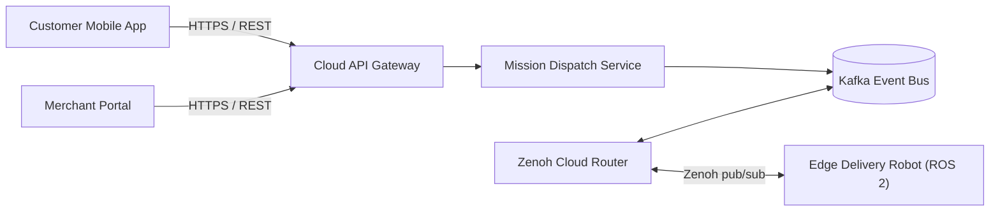

# Autonomous Delivery Robot – Architecture Documentation

Welcome to the central software and system architecture documentation for the **Autonomous Delivery Robot System**.

This documentation follows the **Docs-like-Code** paradigm:
- Stored as Markdown in Git alongside source code
- Automatically rendered in our **Internal Developer Portal (Backstage)** via **TechDocs**
- Linked with Architectural Decisions, API Contracts, and System Models.

---

## 🏛️ System Overview

The system consists of three architectural tiers:
1. **Edge Robotics Tier:** ROS 2 running on NVIDIA Jetson embedded compute nodes inside the robots.
2. **Cloud Fleet Management Tier:** Microservices orchestration dispatching deliveries, routing routes, and handling merchant orders.
3. **Client Tier:** Mobile apps for customers and merchants, plus an operations dashboard for fleet supervisors.

---

## 📑 Architecture Decision Records (ADRs)

Our team documents key technical trade-offs as lightweight ADRs:
- [ADR-001: Adoption of ROS 2 as Robotics Core Middleware](adrs/001-use-ros2-robotics-middleware.md)
- [ADR-002: Using Zenoh for Edge-to-Cloud Telemetry Communication](adrs/002-use-zenoh-edge-to-cloud.md)
- [ADR-003: Contract-First API Design with OpenAPI & AsyncAPI](adrs/003-contract-first-api-design.md)

---

## 📡 Technology Radar Alignment

Our technology choices are continuously tracked in our **Company Technology Radar**:
- **Adopt:** ROS 2, Python, Docker, C++20, Kafka, OpenAPI
- **Trial:** Zenoh, Rust, Canary Rollouts, Foxglove Studio
- **Assess:** TensorRT, ROS 2 micro-ROS, WebAssembly at Edge
- **Hold:** Monolithic Firmware Architectures, SOAP / XML APIs
